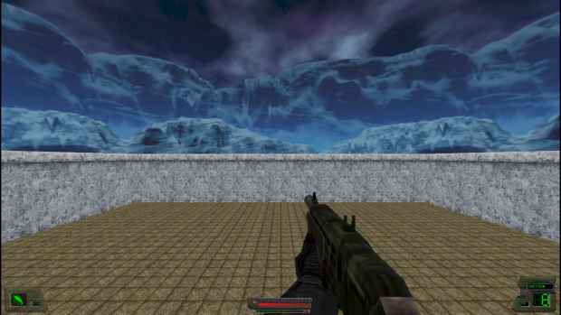
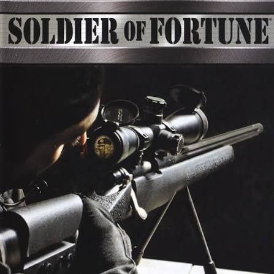

# soldier-of-fortune-2000-syphon-filter-psx
## Soldier of Fortune 2000 - Syphon Filter Remake
A total conversion project that rebuilds the conspiratorial opening and structure of *Syphon Filter* (1999) inside the grungy, early-2000s first-person engine and look of *Soldier of Fortune* (2000), built on the open-sourced Quake II engine source.

## Github Treeview
[https://treegit.macosxjs.com/?url=igiteam/soldier-of-fortune-2000-syphon-filter-psx](https://treegit.macosxjs.com/?url=igiteam/soldier-of-fortune-2000-syphon-filter-psx)

## Github Tree Api Direct JSON
[https://api.github.com/repos/igiteam/soldier-of-fortune-2000-syphon-filter-psx/git/trees/main?recursive=1](https://api.github.com/repos/igiteam/soldier-of-fortune-2000-syphon-filter-psx/git/trees/main?recursive=1)

## Base of the gameplay
[](https://ytembed.macosxjs.com/?d3E4MmV0TFYwYTg)

[](https://ytembed.macosxjs.com/?R2FiQzlFRnduSDQ)

[](https://www.moddb.com/games/soldier-of-fortune/downloads/worldspawn-example)

## Reference Links
[https://archive.org/details/soldier-of-fortune-media](https://archive.org/details/soldier-of-fortune-media)

[https://vimm.net/vault/50771](https://vimm.net/vault/50771)

[https://www.moddb.com/games/soldier-of-fortune/tutorials](https://www.moddb.com/games/soldier-of-fortune/tutorials)

[https://www.moddb.com/games/soldier-of-fortune/downloads](https://www.moddb.com/games/soldier-of-fortune/downloads)

[](https://vimm.net/vault/50771)

[](https://archive.org/details/soldier-of-fortune-media)


---

## WS11WineCX20.0.4 (MacOSX Big Sur 32bit)
[WS11WineCX20.0.4.tar.7z](https://github.com/vitor251093/porting-kit-engines/releases/download/wineskin/WS11WineCX20.0.4.tar.7z)

[](https://github.com/igiteam/wine_engines)

---

# openMERC

openMERC is an open-source (GPL v2) engine for **Soldier of Fortune** (Raven Software, 2000). It is written
clean-room on top of [Yamagi Quake II](https://github.com/yquake2/yquake2) and runs the original game data on
current systems: any resolution, widescreen HUD and menus, an OpenGL 3.2 renderer with optional modern effects,
and an OpenAL sound module.

> **Work in progress.** The engine, renderer, sound and menus are usable; openMERC's own game and player logic
> (mode B) loads and runs all 32 campaign maps but is not finished. Expect bugs - see [docs/KNOWN_ISSUES.md](docs/KNOWN_ISSUES.md).

## Download

Ready-made packages for Windows (`openMERC-<version>-win32.zip`) and Linux x86_64
(`openMERC-<version>-linux-x86_64.tar.gz`) are on the [Releases](https://github.com/sidreshot/openMERC/releases) page.
Each archive goes straight into your Soldier of Fortune folder; the release notes and `openMERC-README.txt` explain
the rest. Both are built from the tagged commit by the [build workflow](.github/workflows/build.yml).

## You need your own copy of the game

openMERC contains **no files of the original game**. You need a legally owned copy of Soldier of Fortune (the GOG
release, or a retail CD updated to 1.07f). openMERC reads the game's `.pak` files from your installation and never
writes into it.

## Status

- **Engine**: all 75 stock maps load and render; Ghoul models, fog, terrain, sky, effects; save/load and level
  changes; console always available.
- **Graphics**: defaults at maximum quality; bloom on emissive surfaces, volumetric fog, soft sun shadows,
  per-pixel dynamic lights, soft particles and other effects, each with its own switch in the Video menu (some are
  still being tuned).
- **Menus**: a new widescreen menu with free fonts (Play, JetBrains Mono) that scale to any resolution and cover
  Latin and Cyrillic text. The parental lock is removed; violence is always at full level.
- **Movement**: Quake II player movement with SoF's differences.
- **Two ways to play**:
  - *mode A* - openMERC engine + the original `gamex86.dll` / `player.dll` from your installation (the most
    complete campaign today);
  - *mode B* - everything open source (engine, renderer, sound, game and player modules). All 32 campaign maps
    load and run; AI, some scripted sequences and some weapon details are unfinished.
- **Multiplayer**: openMERC servers and clients play with each other. Original 1.07f servers, clients and demos are
  **not** compatible (see *Clean room*), and no compatibility mode is planned.
- **Platforms**: Windows (32-bit engine on 64-bit Windows 10/11). Linux x86_64
  (64-bit, OpenMerc's own game modules only): unpack `openMERC-<version>-linux-x86_64.tar.gz` into the game
  folder and run `./openMerc`; building: [docs/BUILD-linux.md](docs/BUILD-linux.md).

## Screenshots

The same places at 2560x1440. Left is the original drawing: the map's own textures and lightmaps, flat glass,
the old warp water, no HDR, no bloom, no modern rain, shadows or post. Right is every graphics option at
maximum. Each of those turns off on its own in the Video menu.

| Original | Every option at maximum |
|---|---|
|  |  |
|  |  |
|  |  |

Both columns are openMERC, from the same game data. The left one is the original path, as close as the port
gets to the 2000 picture.

## Effects rewrite

Every effect of the game is being redrawn with current techniques. The game's own effect data still decides when,
where and how big; only the drawing changes, and each new effect can be switched back to the original look. Details,
the effects of each group and the rules: [docs/EFFECTS.md](docs/EFFECTS.md).

**Progress: 19 of 41 done.**

Done:

- [x] Dynamic lights of shots, fire and explosions
- [x] Smoke and dust lit by the level and by dynamic lights
- [x] Smoke puffs lit as a volume
- [x] Explosion fire ball without its polygon outline
- [x] Soft particles at walls and floors
- [x] Bullet holes with depth
- [x] Wet blood, blood pools under bodies
- [x] Lamp halos as bloom instead of painted sprites
- [x] Rain and thunderstorm with lightning light
- [x] Water: waves, reflections, refraction, foam, fog above and under it
- [x] Splashes in water: spray and rings on the surface
- [x] Hit tint as a dark red vignette
- [x] Night vision as an image intensifier tube
- [x] Contact shadows of bodies instead of the round blob
- [x] Glass with refraction, reflections and dirt
- [x] Thunderstorm: glowing clouds, glare, light through windows, thunder every time
- [x] Rain drops on windows
- [x] Map fog per pixel instead of the old per-vertex fog
- [x] B1. Effect gallery: before and after shots, frame cost

To do:

- [ ] B2. Effects as light sources in HDR and bloom
- [ ] B3. Living flame and smoke, heat haze
- [ ] B4. Fast particles stretched along their motion
- [ ] B5. Cheap path for Low and phones
- [ ] E1. Fire, burning bodies, phosphorus, road flares
- [ ] E2. Flamethrower
- [ ] E3. Explosions
- [ ] E4. Scorch marks
- [ ] E5. Sparks
- [ ] E6. Impacts by material: dust, chunks, glass shards
- [ ] E7. Debris and gibs
- [ ] E8. Tracers
- [ ] E9. Projectiles and trails
- [ ] E10. Muzzle flashes and shell casings
- [ ] E11. MPG, electric arcs, beams
- [ ] E12. Blood and gore
- [ ] E13. Spraying liquids
- [ ] E14. The rest of the water: drips, puddles, debris falling in
- [ ] E15. Smoke and steam of the levels
- [ ] E16. Lava and molten metal
- [ ] E17. Breath in the cold, respawn and teleport
- [ ] C1. Characters really speak: the mouth opens and moves with the voice, no swapped face texture

## Build (Windows)

Requirements:

- Visual Studio 2022 Build Tools (MSVC **x86**), CMake 3.20+, Ninja;
- vcpkg in classic mode with `sdl3:x86-windows` and `openal-soft:x86-windows`;
- Python 3.10+ (data archive, tools, tests).

Set `VCVARSALL` (default `C:\BuildTools\VC\Auxiliary\Build\vcvarsall.bat`) and `OM_VCPKG` (your vcpkg root).
`OM_BUILD_DIR` selects a build directory. From the repository root in `cmd.exe`:

```
tools\build\build-msvc.cmd x86 Release   engine: openMerc.exe, openMerc-ded.exe, ref_gl3.dll, base data zz_openmerc.pak
modules\sound\build.cmd Release          sound module OMsnd.dll (+ OpenAL32.dll, fmt.dll)
game\build.cmd Release                   game module gamex86.dll
player\build.cmd Release                 player module player.dll
```

Assemble a game folder: the engine files and the sound module side by side, `gamex86.dll`, `player.dll` and
`zz_openmerc.pak` in `base\`, and `dist\openMERC.cmd` on top. Start `openMERC.cmd`; on the first start it asks for
your Soldier of Fortune folder (the one that contains `base\pak0.pak`). Settings, saves, screenshots and logs go to
`user\` next to the launcher. For mode A delete `gamex86.dll` and `player.dll` from openMERC's `base\`.

Unit tests built with the engine and modules: `sofpm_test` (player movement), `omghoul_test` (Ghoul model
library), `pm_unit` (player module rules). `python tools/legal_scan.py` checks the tree for copied tables and
forbidden markers.

Release archive: `tools\build\package-win.ps1 -Engine <dir> -Sound <dir> -Game <dir> -Player <dir> -Vcpkg <vcpkg root>`
packs the four build directories into `openMERC-<version>-win32.zip` (+ `.sha256`) in the release layout. Linux:
`tools/build/build-linux.sh && tools/build/package-linux.sh` ([docs/BUILD-linux.md](docs/BUILD-linux.md)).

## Continuous integration

[`.github/workflows/build.yml`](.github/workflows/build.yml) builds Windows x86 (MSVC 2022, vcpkg) and Linux
x86_64 (Debian 13) on every push and pull request, runs the unit tests and keeps both packages as workflow
artifacts. A pushed tag `v*` attaches them to the release of that tag.

## Repository layout

| Directory | Content |
|---|---|
| `engine/` | the engine: Yamagi Quake II base + SoF client, server, Ghoul model system, GL3 renderer, menus |
| `modules/sound/` | sound module `OMsnd.dll` (OpenAL Soft) |
| `game/` | game module `gamex86.dll`: world, AI, damage and gore, navigation, bots, scripts, props, game modes, saves |
| `player/` | player module `player.dll`: weapons, inventory, prediction |
| `data/` | openMERC's own data files (menus, strings, fonts), packed into `base\zz_openmerc.pak` |
| `docs/specs/` | behaviour specifications the implementation is written from |
| `docs/` | clean-room record, deviations from the original, known issues, implementation journals (`docs/impl/`) |
| `tools/`, `tests/` | format readers, pak tools, build scripts, black-box test harnesses |

## Clean room

See [CLEANROOM.md](CLEANROOM.md) and [docs/LEGAL_NOTES.md](docs/LEGAL_NOTES.md). The code was written from
behaviour specifications, the GPL Quake II sources and public documentation; no code of the original executables
is included. The tree contains no data tables copied from the original executables, and the engine never reads
`SoF.exe`. Only the game data (`*.pak`) of a legally owned copy is used.

## License

GPL v2 or later, see [LICENSE](LICENSE). Third-party components and their licenses are listed in
[THIRD_PARTY.md](THIRD_PARTY.md) (Yamagi Quake II and id Software's Quake II sources, SDL3, OpenAL Soft, fmt,
stb, FidelityFX FSR 1 / CAS, SMAA, the OFL fonts; licence texts without a folder of their own in [licenses/](licenses/)). Soldier of Fortune is a trademark of its owners; openMERC is not affiliated with Raven Software
or Activision.

---


## Dev Environment

**Official White Wii Remote With Nunchuk — Tested And Working — £14.99**
[https://www.ebay.co.uk/itm/800847189353](https://www.ebay.co.uk/itm/800847189353)

**Infrared Sensor Bar USB for Wii Emulator Remote Motion Detection Setup — £6.69**
[https://www.ebay.co.uk/itm/227423830875](https://www.ebay.co.uk/itm/227423830875)

**Apple MacBook Pro Retina 15in (2014) i7 2.8GHz 16GB 1TB SSD GT 750M — £120.30**
[https://www.ebay.co.uk/itm/800844561513](https://www.ebay.co.uk/itm/800844561513)

**WS11WineCX20.0.4 (Wine engine)**
[https://igiteam.github.io/wine_engines/](https://igiteam.github.io/wine_engines/)

**Official Genuine Sony PS3 PlayStation 3 DualShock 3 Wireless Controller Black — £19.99**
[https://www.ebay.co.uk/itm/840031043465](https://www.ebay.co.uk/itm/840031043465)

**Amazon Basics 4K HDMI Cable 3m — 18Gbps High Speed with Ethernet, 4K@60Hz, 2160p — £8.44**
[https://www.ebay.co.uk/itm/327352257557](https://www.ebay.co.uk/itm/327352257557)

**wiimote_nunchuk_macosx**
[https://github.com/igiteam/wiimote-nunchuk](https://github.com/igiteam/wiimote-nunchuk)

**xbox360_input_gui_py**
[https://github.com/igiteam/xbox360_input_gui_py](https://github.com/igiteam/xbox360_input_gui_py)

**logitec_mx_mouse_3_macos**
[https://github.com/igiteam/logitec_mx_mouse_3_macos](https://github.com/igiteam/logitec_mx_mouse_3_macos)

**igi1-macbook-3d-workstation**
[https://github.com/igiteam/igi1-macbook-3d-workstation](https://github.com/igiteam/igi1-macbook-3d-workstation)

---


